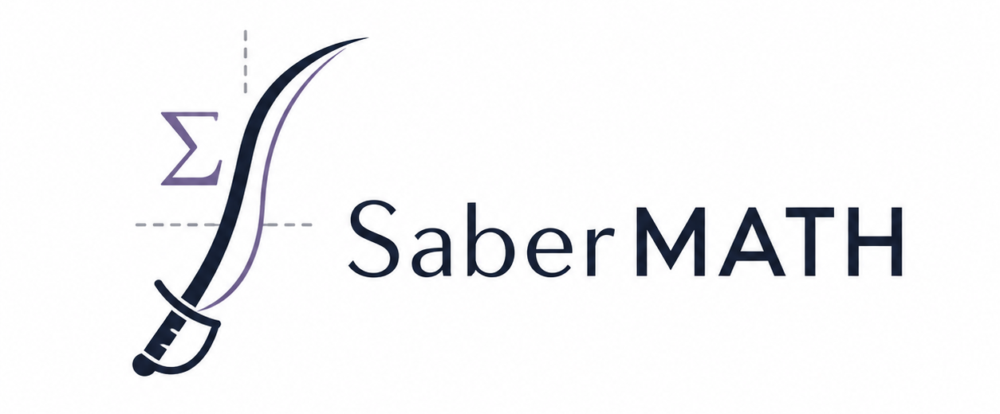

<div align="center">
  
</div>

# SABER-Math

`sabermath` evaluates retrieval and reranking models on SABER-Math, a benchmark for mathematical information retrieval. For each of 1,000 math problems, your model ranks 150 candidate solved problems, and the ranking is scored with nDCG@k against graded relevance labels.

You use the package through two things:

- **`sabermath.evaluate()`** runs the benchmark and returns a report.
- **Processors** wrap a model so `evaluate` can score with it. Sentence Transformers, vLLM and OpenRouter are built in, and you can write your own by subclassing `EmbeddingProcessor` or `ModelProcessor`.

Full documentation: [`docs/`](docs/index.rst).

## Installation

Python 3.10 or newer.

```bash
git clone https://github.com/insait-institute/sabermath
cd sabermath
python -m pip install -e .            # Sentence Transformers + OpenRouter
python -m pip install -e ".[vllm]"    # adds vLLM (needs a GPU)
```

## Evaluating a model

```python
import sabermath

report = sabermath.evaluate("BAAI/bge-m3")

for task in report.tasks:
    print(task.task, round(task.ndcg_at_k, 4))
```

A model id is loaded with Sentence Transformers (or vLLM with `use_vllm=True`). The benchmark data is downloaded from Hugging Face on first use.

The main options:

```python
report = sabermath.evaluate(
    "Qwen/Qwen3-Embedding-0.6B",
    tasks=["statement-full"],        # default: all three tasks
    k=10,                            # nDCG cut-off
    dcg_variant="exponent",          # or "linear"
    init_kwargs={"device": "cuda"},  # how to build the model
    scores_kwargs={                  # passed to every scoring call
        "batch_size": 32,
        "query_encode_kwargs": {"prompt_name": "query"},
    },
    instruction="Given a math problem, retrieve mathematically relevant problems",
)
```

| Task | Query | Documents |
|---|---|---|
| `statement-statement` | problem | problem |
| `statement-full` (main) | problem | problem + solution |
| `full-full` | problem + solution | problem + solution |

`report` holds the nDCG@k of each task, broken down by branch of mathematics (Algebra, Geometry, Number Theory, Combinatorics, Calculus and Analysis). `report.to_dict()` gives plain JSON-ready data, and `return_ndcgs=True` also returns the score of every query.

## Built-in processors

| Processor | How to get it |
|---|---|
| `SentenceTransformersProcessor` | `evaluate("model/id")`, or pass a `SentenceTransformer` |
| `VLLMProcessor` | `evaluate("model/id", use_vllm=True)`, or pass a `vllm.LLM` |
| `OpenRouterEmbeddingProcessor` | `evaluate(OpenRouterEmbeddingProcessor("provider/model"))` |

```python
from sabermath.processors import OpenRouterEmbeddingProcessor

# API key from OPENROUTER_API_KEY or api_key=...
report = sabermath.evaluate(OpenRouterEmbeddingProcessor("openai/text-embedding-3-large"))
```

All three are embedding processors: they embed the query and its candidates and score by cosine similarity. They accept `query_prompt`, `document_prompt`, `query_suffix`, `document_suffix`, `query_encode_kwargs` and `document_encode_kwargs` in `scores_kwargs`.

## Writing your own processor

Pass any processor instance to `evaluate`. Choose the base class by how your model scores.

### An embedding model: subclass `EmbeddingProcessor`

Implement `encode`, returning one vector per text. Cosine scoring and the prompt options above come with the base class.

```python
import numpy as np
import sabermath
from sabermath.processors import EmbeddingProcessor

class MyEmbeddingProcessor(EmbeddingProcessor):
    processor = "my-backend"          # required; shown as report.processor

    def __init__(self, client, model_name):
        self._client = client
        self._model_name = model_name

    @property
    def model(self):                  # shown as report.model
        return self._model_name

    def encode(self, texts, show_progress_bar=True, **kwargs) -> np.ndarray:
        # must return shape (len(texts), dim), rows in input order
        return np.asarray(self._client.embed(texts, **kwargs))

report = sabermath.evaluate(MyEmbeddingProcessor(client, "my-model"))
```

### Anything else: subclass `ModelProcessor`

Implement `get_scores`, returning one score per document (higher = more relevant). Use this for rerankers, lexical baselines, or custom similarity.

```python
from sentence_transformers import CrossEncoder
from sabermath.processors import ModelProcessor

class CrossEncoderProcessor(ModelProcessor):
    processor = "cross-encoder"

    def __init__(self, model_name):
        self._model_name = model_name
        self._model = CrossEncoder(model_name)

    @property
    def model(self):
        return self._model_name

    def get_scores(self, query, documents, *, show_progress_bar=True, **kwargs):
        return self._model.predict([(query, d) for d in documents], **kwargs)

report = sabermath.evaluate(
    CrossEncoderProcessor("cross-encoder/ms-marco-MiniLM-L6-v2"),
    scores_kwargs={"batch_size": 150},
)
```

`evaluate` calls `get_scores(query, documents, show_progress_bar=False, **scores_kwargs)` once per query, where `documents` is the query's 150 candidate texts. Return `None` to skip a query; it is then left out of the averages.

See [`docs/custom_processors.rst`](docs/custom_processors.rst) for the full contract and more examples (Hugging Face mean pooling, query/document-specific encoding, caching, BM25).

## Building the documentation

```bash
python -m pip install -r docs/requirements.txt
sphinx-build -b html docs docs/_build/html
```

## License

[CC BY-SA 4.0](LICENCE).

## Citation

```bibtex
@inproceedings{
  georgiev2026sabermath,
  title={{SABER}-Math: An Automated Reranking Benchmark for Mathematical Information Retrieval},
  author={Anonymous},
  booktitle={The 2026 Conference on Empirical Methods in Natural Language Processing},
  year={2026},
  url={https://openreview.net/forum?id=Tb2EKLtAS0}
}
```
