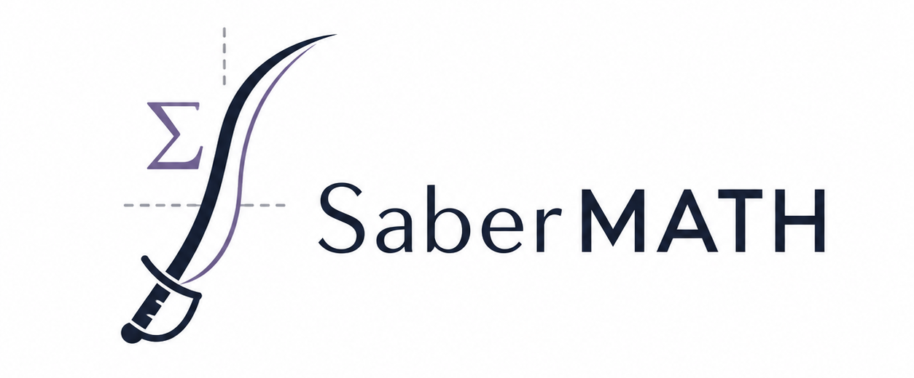
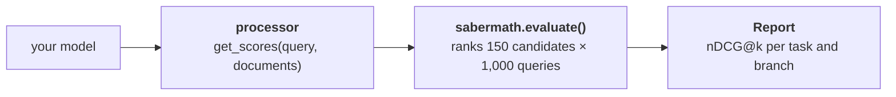

<div align="center">
  

# SABER-Math documentation

[Paper](https://arxiv.org/abs/2606.29894) · [Website](https://sabermath.insait.ai) · [Data](https://huggingface.co/collections/INSAIT-Institute/saber-math) · [Project README](../README.md)

</div>

`sabermath` evaluates retrieval and reranking models on **SABER-Math**, a benchmark for mathematical information retrieval.
For each of 1,000 math problems, your model ranks 150 candidate solved problems, and the ranking is scored with nDCG@10
against graded relevance ratings.

```python
import sabermath

report = sabermath.evaluate("BAAI/bge-m3")
```

## Where to start

| I want to… | Read |
|---|---|
| understand what the benchmark measures | [The benchmark](benchmark.md) |
| install the package | [Installation](installation.md) |
| evaluate a Hugging Face, vLLM or OpenRouter model | [Running `evaluate()`](evaluate.md) and [Built-in processors](processors.md) |
| evaluate my own model, a reranker or a baseline | [Writing a processor](custom-processors.md) |
| reproduce the paper's numbers | [Matching the paper's protocol](evaluate.md#matching-the-papers-protocol) |
| look up a signature | [API reference](api.md) |

## All pages

1. **[The benchmark](benchmark.md)**: the task, the three settings, the metric, how the labels were made, the data, reference results
2. **[Installation](installation.md)**: pip install, the vLLM extra, API keys, a quick check
3. **[Running `evaluate()`](evaluate.md)**: every argument, the report, instructions, recipes, troubleshooting
4. **[Built-in processors](processors.md)**: Sentence Transformers, vLLM, OpenRouter, and the shared embedding options
5. **[Writing a processor](custom-processors.md)**: the processor contract, `EmbeddingProcessor` and `ModelProcessor` with worked examples, testing
6. **[API reference](api.md)**: signatures of everything public

## The two concepts



- **`evaluate()`** runs the benchmark. → [Running `evaluate()`](evaluate.md)
- A **processor** wraps a model so that `evaluate()` can ask it for scores. Several are built in, and you can
  write your own in a few lines. → [Built-in processors](processors.md) · [Writing a processor](custom-processors.md)

---

<table width="100%"><tr>
<td align="left">↩ <a href="../README.md">Project README</a></td>
<td align="right"><a href="benchmark.md">The benchmark</a> →</td>
</tr></table>
