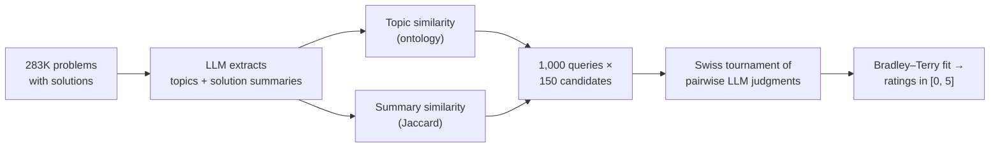

[Docs](README.md) › **The benchmark**

# The SABER-Math benchmark

SABER-Math (**S**calable **A**utomated **BE**nchmark for **R**eranking in **Math**)
tests whether a retrieval system can tell when two math problems are actually related.
Related here means they share concepts, theorems or solution techniques, not just surface wording.
It was built with no expert annotation. This page summarizes the [paper](https://arxiv.org/abs/2606.29894)
for people who want to *use* the benchmark. Read the paper for the full methodology and analysis.

**On this page:** [The task](#the-task) · [Three settings](#three-settings) · [Metric](#metric) ·
[Branches of mathematics](#branches-of-mathematics) · [How the labels were made](#how-the-relevance-labels-were-made) ·
[The data](#the-data) · [Reference results](#reference-results) · [Limitations](#limitations) · [License](#license)

---

## The task

SABER-Math is a **reranking** benchmark, not open-corpus retrieval:

- **1,000 queries.** Each one is a high-school or olympiad-level problem.
- **150 candidates per query.** Each candidate is another solved problem drawn from a pool of about 71K documents.
- **Graded relevance.** Every candidate has a continuous relevance rating in **[0, 5]**.

Your model scores the 150 candidates of each query. The ranking it produces is compared with the
reference ratings using nDCG@10.

Two cheap signals pick the candidates for each query:

| Group | Count | Selected because… |
|---|---|---|
| topic-only | 50 | the two problems share related topics in a mathematical ontology |
| summary-only | 50 | short summaries of their solutions use similar words, which suggests a similar method |
| both | 50 | both of the above |

Most candidates therefore look related at first sight, so the model has to recognize *how* related they are.
These signals select candidates only. The final relevance ratings come from an LLM judge
(see [below](#how-the-relevance-labels-were-made)).

## Three settings

The same queries and candidates are scored in three settings, which differ in what text the model sees.
In the code they're called *tasks*:

| Task | Query text | Document text | Models the use case |
|---|---|---|---|
| `statement-statement` | problem | problem | searching collections with no solutions (theorem statements, formal-library declarations) |
| **`statement-full`** (main) | problem | problem + solution | given a new problem, retrieve *solved* examples that help solve it |
| `full-full` | problem + solution | problem + solution | searching solved material: deduplication, solution schemas, knowledge graphs |

"Problem + solution" is the string `"Problem: {problem}\n\nSolution: {solution}"`.
Unless stated otherwise, the paper reports **`statement-full`**.

## Metric

The score is **nDCG@10 with exponential gain**, computed per query and averaged over queries:

```math
\mathrm{DCG@}k = \sum_{i=1}^{k} \frac{2^{r_i} - 1}{\log_2(i + 1)}, \qquad
\mathrm{nDCG@}k = \frac{\mathrm{DCG@}k}{\mathrm{IDCG@}k}
```

Here $r_i$ is the reference rating of the document your model put at rank $i$, and IDCG is the DCG of the ideal ordering.
Normalizing per query gives every query the same weight in the final score.

The paper (App. D.3) shows that the model ranking hardly depends on this choice.
Switching to linear gain reorders only 9 of 861 model pairs, all of them neighbours within 0.0042.
`evaluate()` supports both variants (`dcg_variant="exponent"` or `"linear"`).

## Branches of mathematics

The queries are spread evenly over five branches: **Algebra**, **Geometry**, **Number Theory**,
**Combinatorics**, and **Calculus and Analysis**. Some queries are tagged with two branches.
`evaluate()` reports a score for each branch next to the overall score.

The paper finds that even the strongest systems do worse on symbol-heavy branches (Algebra, Number Theory, Calculus)
than on Geometry and Combinatorics, so the per-branch scores are worth checking.

## How the relevance labels were made



1. **Corpus.** About 283K deduplicated problem–solution pairs from AoPS forums,
   official competitions (IMO, USAMO, RMM, …) and the olympiad split of NuminaMath-1.5.
2. **Topics.** GPT-OSS-120B tags each problem with topics from an ontology derived from Wolfram MathWorld.
   Topic similarity between two problems is computed over the ontology tree:
   Lin similarity between individual topics, then a best-match average over the two problems' topic sets.
3. **Solution summaries.** The same LLM writes a hint of at most 30 words describing each solution's core idea.
   Summary similarity is the Jaccard word overlap of two hints.
   The overlap is lexical on purpose, so that the benchmark is not biased toward any embedding model.
4. **Candidate selection.** Thresholds on the two similarities give the three groups of 50 candidates
   described in [The task](#the-task).
5. **Ratings.** For each query, GPT-OSS-120B compares pairs of candidates and says which one is more relevant to the query.
   A 20-round Swiss-style tournament chooses the pairs, so judge calls go to close contests.
   A Bradley–Terry model turns the pairwise outcomes into one score per candidate,
   and those scores are rescaled linearly to [0, 5].

Expert annotators checked both the judge and the resulting benchmark (paper, App. D.4).

## The data

`evaluate()` downloads two Hugging Face datasets the first time it runs
(collection: [INSAIT-Institute/saber-math](https://huggingface.co/collections/INSAIT-Institute/saber-math)):

| Dataset | Rows | Columns used by `sabermath` |
|---|---|---|
| `INSAIT-Institute/SaberMath-queries` | 1,000 | `problem`, `solution`, `candidates` (150 row indices into the documents dataset), `relevance_scores` (150 ratings, aligned with `candidates`), `domains` |
| `INSAIT-Institute/SaberMath-documents` | 71,117 | `problem`, `solution` |

Both datasets also contain `answer`, `tags`, `idea` (the solution summary), `metadata` and more. The queries dataset adds
`bma_scores` and `jaccard_scores` (the two selection signals). You can load them yourself:

```python
from sabermath.data import load_data

queries, documents = load_data()
q = queries[0]
print(q["problem"])
print(q["domains"])
top = max(range(150), key=lambda i: q["relevance_scores"][i])
print(documents[q["candidates"][top]]["problem"])   # the most relevant candidate
```

## Reference results

Below are selected nDCG@10 scores from Table 1 of the paper, in the main `statement-full` setting.
The paper evaluates 42 systems.

| System | Type | statement-full | statement-statement | full-full |
|---|---|---|---|---|
| ReasonReranker-Qwen3-32B-Rewrite | reasoning cross-encoder + rewriter | **0.741** | 0.638 | 0.796 |
| ReasonEmbed-Qwen3-8B | reasoning bi-encoder | 0.710 | **0.685** | 0.795 |
| RaDeR-7B | reasoning bi-encoder | 0.690 | 0.671 | 0.738 |
| Qwen3-Reranker-4B | cross-encoder | 0.683 | 0.653 | 0.730 |
| Qwen3-Embedding-4B | bi-encoder | 0.615 | 0.597 | 0.667 |
| Qwen3-Embedding-0.6B | bi-encoder | 0.575 | 0.566 | 0.625 |
| Text-Embedding-3-Large | API bi-encoder | 0.557 | 0.540 | 0.594 |
| BGE-m3 | bi-encoder | 0.511 | 0.505 | 0.563 |
| BM25 (math tokenizer) | lexical | 0.416 | 0.426 | 0.437 |
| BERT | bi-encoder | 0.357 | 0.416 | 0.429 |

As a rough calibration, a random ranking scores about **0.29**.
Reasoning-trained retrievers lead, general-purpose embedders follow, and lexical and older encoders trail.
The paper also reports that MTEB retrieval scores separate the strongest recent models poorly.
For example, Harrier-27b ranks first on MTEB but behind several smaller models here.

Your numbers can differ slightly from the paper's: the backend (vLLM or Sentence Transformers),
the precision and the input format all matter.
[Matching the paper's protocol](evaluate.md#matching-the-papers-protocol) lists the settings the paper used.

## Limitations

- **Level.** The problems are mostly high-school, olympiad and early-undergraduate level.
  Results may not carry over to research mathematics, formal libraries or textbooks.
- **Reranking only.** Each query has a fixed pool of 150 candidates, which is what makes it possible to rate every candidate.
  First-stage retrieval over the full corpus is not measured.
- **Automated labels.** LLM processing can add noise to individual labels.
  The paper's human validation finds the ratings reliable *for comparing systems*.

## License

The material the authors created (ontology, annotations, query/candidate selection, judgments, ratings) is released under
[CC BY-SA 4.0](../LICENCE). The problem and solution texts keep the license of their original source
(for example, the NuminaMath-1.5 portion stays under Apache 2.0). See the paper, App. A.8.

---

<table width="100%"><tr>
<td align="left">← <a href="README.md">Docs home</a></td>
<td align="right"><a href="installation.md">Installation</a> →</td>
</tr></table>
