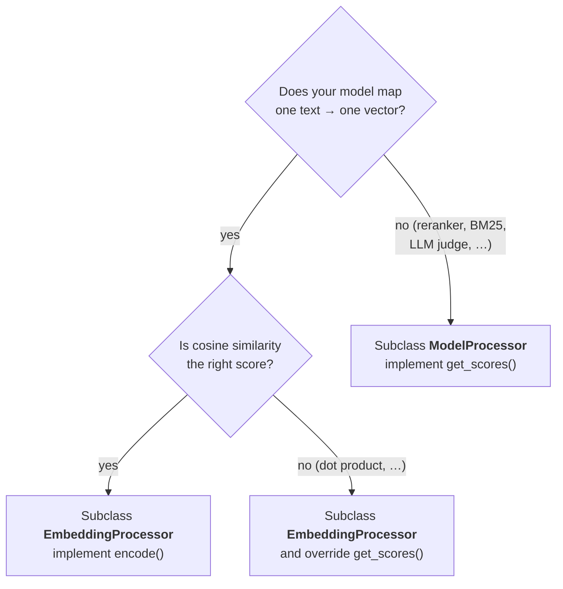

[Docs](README.md) › **Writing a processor**

# Writing your own processor

Some models aren't covered by the [built-in processors](processors.md): your own PyTorch model, an embedding API,
a cross-encoder reranker, an LLM judge, a lexical baseline. To evaluate one, write a small class and pass an instance to `evaluate()`:

```python
report = sabermath.evaluate(MyProcessor(...))
```

**On this page:** [Choose a base class](#choose-a-base-class) · [How `evaluate` calls your processor](#how-evaluate-calls-your-processor) ·
[The processor contract](#the-processor-contract) · [Subclassing `EmbeddingProcessor`](#subclassing-embeddingprocessor) ·
[Subclassing `ModelProcessor`](#subclassing-modelprocessor) · [Skipping a query](#skipping-a-query) ·
[Testing your processor](#testing-your-processor) · [Checklist](#checklist)

---

## Choose a base class



| Base class | Use it when | You implement | You get for free |
|---|---|---|---|
| `EmbeddingProcessor` | the model turns a text into a vector | `encode(texts) -> array` | cosine scoring, the [prompt/suffix options](processors.md#options-shared-by-all-embedding-processors), separate query and document arguments |
| `ModelProcessor` | the model scores (query, document) pairs, or anything that isn't "embed, then cosine" | `get_scores(query, documents) -> scores` | full control |

Both classes import from `sabermath.processors`. `EmbeddingProcessor` is also available as `sabermath.EmbeddingProcessor`.

## How `evaluate` calls your processor

For every task and each of its 1,000 queries, `evaluate` makes exactly one call:

```python
scores = processor.get_scores(query, documents, show_progress_bar=False, **scores_kwargs)
```

| Argument | What it is |
|---|---|
| `query` | `str`: the problem statement, or `"Problem: …\n\nSolution: …"` for `full-full`, already wrapped in the [instruction](evaluate.md#instructions) if one was given |
| `documents` | `list[str]` of the query's 150 candidates: problem statements for `statement-statement`, `"Problem: …\n\nSolution: …"` otherwise |
| `show_progress_bar` | always `False`, because `evaluate` shows its own bar over queries |
| `**scores_kwargs` | the dict you passed to `evaluate` (empty by default), unchanged |

The candidates are then sorted by the returned scores, highest first, and the ranking is scored with nDCG@k.
Only the *order* of the scores matters. Their scale doesn't, so logits, probabilities and distances
(negated) all work.

## The processor contract

Every processor has three parts, whichever base class it uses:

| Part | Required? | Purpose |
|---|---|---|
| `processor` class attribute | **yes** | short backend name, reported as `report.processor`. It may be `None`, which is reported as `"unknown"` |
| `model` property | no | the model's name, reported as `report.model`. The default returns `None`, reported as `"unknown"` |
| `get_scores` method | yes | inherited from `EmbeddingProcessor`, or written by you for `ModelProcessor` |

> [!IMPORTANT]
> If the class doesn't define `processor`, `evaluate` raises `AttributeError` while building the report,
> **after** all the scoring has run. Define it first.

Put configuration in your `__init__`. `evaluate` rejects `init_kwargs` when it gets a processor instance.
Options that change from run to run belong in `scores_kwargs`, which reach your `encode` or `get_scores` as keyword arguments.

### Minimal templates

<table>
<tr><th>Embedding model</th><th>Anything else</th></tr>
<tr><td>

```python
import numpy as np
from sabermath.processors import EmbeddingProcessor

class MyEmbedder(EmbeddingProcessor):
    processor = "my-backend"

    def __init__(self, name):
        self._name = name
        self._model = load_my_model(name)

    @property
    def model(self):
        return self._name

    def encode(self, texts, show_progress_bar=True, **kwargs):
        # shape: (len(texts), dim), input order
        return np.asarray(self._model.embed(texts))
```

</td><td>

```python
from sabermath.processors import ModelProcessor

class MyScorer(ModelProcessor):
    processor = "my-scorer"

    def __init__(self, name):
        self._name = name
        self._model = load_my_model(name)

    @property
    def model(self):
        return self._name

    def get_scores(self, query, documents, *,
                   show_progress_bar=True, **kwargs):
        # one float per document, higher = more relevant
        return [self._model.score(query, d) for d in documents]
```

</td></tr>
</table>

## Subclassing `EmbeddingProcessor`

Implement one method:

```python
def encode(self, texts: list[str], show_progress_bar: bool = True, **kwargs) -> np.ndarray:
    ...
```

**Requirements:**

- Return an array of shape `(len(texts), dim)`, one row per input text, **in input order**.
- No row may be all zeros. Cosine similarity is undefined for a zero vector, and `evaluate` raises `ValueError`.
- Accept `**kwargs`, or name the options you support. `encode` receives every `scores_kwargs` key except the six
  [shared options](processors.md#options-shared-by-all-embedding-processors).
- You don't need to normalize, because cosine similarity normalizes for you.

**What the inherited `get_scores` does:**

1. It applies `query_prompt` / `query_suffix` / `document_prompt` / `document_suffix`, if given.
2. It embeds the texts:
   - by default, with **one** call, `encode(documents + [query], **kwargs)`, so the query is the **last** row;
   - if `query_encode_kwargs` or `document_encode_kwargs` is given, with **two** calls,
     `encode(documents, **{**kwargs, **document_encode_kwargs})` and then `encode([query], **{**kwargs, **query_encode_kwargs})`.
3. It returns the cosine similarity of each document embedding to the query embedding.

### Example: a Hugging Face model with mean pooling

```python
import numpy as np
import torch
from transformers import AutoModel, AutoTokenizer

import sabermath
from sabermath.processors import EmbeddingProcessor


class MeanPoolingProcessor(EmbeddingProcessor):
    processor = "transformers-mean-pooling"

    def __init__(self, model_name, device="cpu", max_length=512):
        self._model_name = model_name
        self._device = device
        self._max_length = max_length
        self._tokenizer = AutoTokenizer.from_pretrained(model_name)
        self._model = AutoModel.from_pretrained(model_name).to(device).eval()

    @property
    def model(self):
        return self._model_name

    @torch.no_grad()
    def encode(self, texts, show_progress_bar=True, batch_size=32, **kwargs):
        vectors = []
        for start in range(0, len(texts), batch_size):
            batch = self._tokenizer(
                texts[start : start + batch_size],
                padding=True,
                truncation=True,
                max_length=self._max_length,
                return_tensors="pt",
            ).to(self._device)
            hidden = self._model(**batch).last_hidden_state
            mask = batch["attention_mask"].unsqueeze(-1).to(hidden.dtype)
            pooled = (hidden * mask).sum(dim=1) / mask.sum(dim=1)
            vectors.append(pooled.float().cpu().numpy())
        return np.concatenate(vectors)


processor = MeanPoolingProcessor("BAAI/bge-small-en-v1.5", device="cuda")
report = sabermath.evaluate(processor, scores_kwargs={"batch_size": 64})
```

The `batch_size` key in `scores_kwargs` arrives as the `batch_size` argument of `encode`.

### Example: different handling for queries and documents

Many embedding APIs want to know whether a text is a query or a document (`input_type`, `task_type`, …).
Give `encode` a parameter for it and set it for each side with `query_encode_kwargs` / `document_encode_kwargs`:

```python
class MyAPIProcessor(EmbeddingProcessor):
    processor = "my-api"

    def __init__(self, client, model_name):
        self._client = client
        self._model_name = model_name

    @property
    def model(self):
        return self._model_name

    def encode(self, texts, show_progress_bar=True, input_type="document", **kwargs):
        response = self._client.embed(texts, model=self._model_name, input_type=input_type, **kwargs)
        return np.asarray(response)


report = sabermath.evaluate(
    MyAPIProcessor(client, "embed-v1"),
    scores_kwargs={"query_encode_kwargs": {"input_type": "query"}},
)
```

The documents are encoded with the default `input_type="document"` and the query with `input_type="query"`.
The paper ran Gemini-001 this way, with `task_type=RETRIEVAL_QUERY` / `RETRIEVAL_DOCUMENT`.

### Example: caching embeddings

`encode` is called once per query, so the same document is re-embedded every time it appears in a candidate list, both
within a task and across the tasks. Nothing is cached for you. If encoding is slow or costs money, cache inside your processor:

```python
class CachedMeanPoolingProcessor(MeanPoolingProcessor):
    def __init__(self, *args, **kwargs):
        super().__init__(*args, **kwargs)
        self._cache = {}

    def encode(self, texts, show_progress_bar=True, **kwargs):
        options = repr(sorted(kwargs.items()))
        missing = [t for t in dict.fromkeys(texts) if (t, options) not in self._cache]
        if missing:
            vectors = super().encode(missing, show_progress_bar, **kwargs)
            for text, vector in zip(missing, vectors):
                self._cache[(text, options)] = vector
        return np.stack([self._cache[(t, options)] for t in texts])
```

The cache key includes the `encode` options, so the query-side and document-side embeddings of the same text are stored separately.
The prompts and suffixes are already part of the text by the time `encode` sees it, so they're covered as well.

### Example: changing the similarity function

To score with something other than cosine similarity, such as the dot product, override `get_scores` and call `self.encode` yourself:

```python
class DotProductProcessor(MeanPoolingProcessor):
    def get_scores(self, query, documents, *, show_progress_bar=True, **kwargs):
        vectors = self.encode(documents + [query], show_progress_bar, **kwargs)
        return vectors[:-1] @ vectors[-1]
```

> [!NOTE]
> An overridden `get_scores` no longer handles the prompt, suffix and per-side options unless you implement them.
> The helpers `split_affix_kwargs` and `apply_affixes` in `sabermath.processors.embedding_processor` can help.

## Subclassing `ModelProcessor`

Implement `get_scores`:

```python
def get_scores(
    self,
    query: str,
    documents: list[str],
    *,
    show_progress_bar: bool = True,
    **kwargs,
) -> list[float] | np.ndarray | None:
    ...
```

Return one number per document, in the order of `documents`. Higher means more relevant.
A list or a 1-D NumPy array both work. `kwargs` receives all of `scores_kwargs`.

### Example: a cross-encoder reranker

```python
from sentence_transformers import CrossEncoder

import sabermath
from sabermath.processors import ModelProcessor


class CrossEncoderProcessor(ModelProcessor):
    processor = "cross-encoder"

    def __init__(self, model_name, **kwargs):
        self._model_name = model_name
        self._model = CrossEncoder(model_name, **kwargs)

    @property
    def model(self):
        return self._model_name

    def get_scores(self, query, documents, *, show_progress_bar=True, batch_size=32, **kwargs):
        pairs = [(query, document) for document in documents]
        return self._model.predict(pairs, batch_size=batch_size, show_progress_bar=show_progress_bar)


report = sabermath.evaluate(
    CrossEncoderProcessor("cross-encoder/ms-marco-MiniLM-L6-v2"),
    scores_kwargs={"batch_size": 150},   # all candidates of a query in one batch
)
```

### Example: a lexical baseline (BM25)

A processor doesn't need a neural model. This BM25 scorer computes its term statistics over each query's 150 candidates,
the same pool-local indexing the paper uses (App. C.4):

```python
import math
import re
from collections import Counter

from sabermath.processors import ModelProcessor


def tokenize(text):
    return re.findall(r"\w+", text.lower())


class BM25Processor(ModelProcessor):
    processor = "bm25"

    def __init__(self, k1=1.5, b=0.75):
        self.k1 = k1
        self.b = b

    @property
    def model(self):
        return f"bm25-k1={self.k1}-b={self.b}"

    def get_scores(self, query, documents, *, show_progress_bar=True, **kwargs):
        docs = [tokenize(d) for d in documents]
        n = len(docs)
        avg_len = sum(len(d) for d in docs) / n or 1.0
        df = Counter(term for d in docs for term in set(d))
        query_terms = set(tokenize(query))

        scores = []
        for d in docs:
            tf = Counter(d)
            score = 0.0
            for term in query_terms & tf.keys():
                idf = math.log(1 + (n - df[term] + 0.5) / (df[term] + 0.5))
                norm = 1 - self.b + self.b * len(d) / avg_len
                score += idf * tf[term] * (self.k1 + 1) / (tf[term] + self.k1 * norm)
            scores.append(score)
        return scores
```

The paper's BM25 (0.416 on `statement-full`) uses `rank_bm25` with a mathematics-aware tokenizer.
This example uses a plain word tokenizer, so expect a somewhat different score.

### Example: wrapping any scoring function

For quick experiments you can adapt a plain function:

```python
class FunctionProcessor(ModelProcessor):
    processor = "function"

    def __init__(self, fn, name):
        self._fn, self._name = fn, name

    @property
    def model(self):
        return self._name

    def get_scores(self, query, documents, *, show_progress_bar=True, **kwargs):
        return self._fn(query, documents, **kwargs)


def length_baseline(query, documents):
    return [-abs(len(d) - len(query)) for d in documents]

sabermath.evaluate(FunctionProcessor(length_baseline, "length-baseline"))
```

## Skipping a query

Return `None` from `get_scores` when the model can't score a query, for example when an API refused the request.
That query is recorded as `None` in the [per-query results](evaluate.md#return_ndcgs) and left out of the task and branch averages.

> [!CAUTION]
> Skipped queries make scores incomparable. Always count them before comparing models:
>
> ```python
> report, ndcgs = sabermath.evaluate(processor, return_ndcgs=True)
> skipped = {task: sum(v is None for v in values) for task, values in ndcgs.items()}
> ```

## Testing your processor

**1. Call it directly on one real query.** This checks the shape, order and speed before a long run:

```python
import numpy as np
from sabermath.data import load_data

queries, documents = load_data()
q = queries[0]
docs = [documents[i]["problem"] for i in q["candidates"]]

scores = np.asarray(processor.get_scores(q["problem"], docs, show_progress_bar=False))
assert scores.shape == (150,), scores.shape
assert np.isfinite(scores).all()

relevance = np.asarray(q["relevance_scores"])
print("relevance of your top-5:", relevance[np.argsort(-scores)[:5]].round(2))
print("best possible top-5:    ", np.sort(relevance)[::-1][:5].round(2))
```

**2. Run `evaluate` on a subset:**

```python
report = sabermath.evaluate(
    processor,
    tasks=["statement-full"],
    queries=queries.select(range(20)),
    documents=documents,
)
print(report.tasks[0].ndcg_at_k)
```

A model that ranks at random scores about **0.29** nDCG@10 with the default exponential gain, on every task.
A working retriever should be clearly above that. Expect some noise with only 20 queries.
For orientation, [Reference results](benchmark.md#reference-results) lists published scores.

## Checklist

- [ ] The class defines `processor = "..."`.
- [ ] `model` returns a descriptive name, so your saved reports are self-explanatory.
- [ ] `encode` returns `(len(texts), dim)` in input order, or `get_scores` returns `len(documents)` scores, higher = better.
- [ ] Your method accepts `**kwargs`, so unrelated `scores_kwargs` keys don't break it.
- [ ] Configuration is in `__init__`, not in `init_kwargs`.
- [ ] Slow or paid models cache their embeddings.
- [ ] You checked how many queries were skipped (`None`).
- [ ] A 20-query run scores clearly above 0.29.

---

<table width="100%"><tr>
<td align="left">← <a href="processors.md">Built-in processors</a></td>
<td align="right"><a href="api.md">API reference</a> →</td>
</tr></table>
