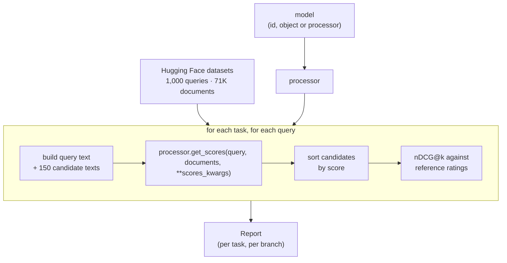

[Docs](README.md) › **Running `evaluate()`**

# Running `evaluate()`

`sabermath.evaluate()` is the package's main entry point. You give it a model and it returns a report.
For quick runs from the shell, see [Command line](cli.md).

**On this page:** [Quickstart](#quickstart) · [What happens during a run](#what-happens-during-a-run) ·
[What `model` can be](#what-model-can-be) · [Arguments](#arguments) · [The report](#the-report) ·
[Instructions](#instructions) · [Recipes](#recipes) · [Matching the paper's protocol](#matching-the-papers-protocol) ·
[Troubleshooting](#troubleshooting)

---

## Quickstart

```python
import sabermath

report = sabermath.evaluate("BAAI/bge-m3")

for task in report.tasks:
    print(f"{task.task:22} {task.ndcg_at_k:.4f}")
    for branch in task.branches:
        print(f"    {branch.branch:22} {branch.ndcg_at_k:.4f}")
```

For reference, the paper reports 0.505 / 0.511 / 0.563 for BGE-m3 on the three tasks.
Small differences from those numbers are expected, see [Matching the paper's protocol](#matching-the-papers-protocol).

By default this runs all three tasks with nDCG@10 and exponential gain, the paper's setting.
To run only the main task, pass `tasks=["statement-full"]`.

## What happens during a run



1. **Wrap the model.** `model` becomes a *processor*, the object that scores documents
   (see [What `model` can be](#what-model-can-be)).
2. **Load the data.** Both datasets are downloaded once and cached by 🤗 Datasets.
3. **Score each query.** For each task and each of the 1,000 queries, `evaluate` builds the query text and
   the texts of its 150 candidates. It optionally wraps the query in an [instruction](#instructions), then calls
   `processor.get_scores(query, documents, show_progress_bar=False, **scores_kwargs)`.
4. **Rank and measure.** The candidates are sorted by score, highest first, and nDCG@k is computed against the
   reference ratings.
5. **Report.** The per-query nDCGs are averaged, over all queries and separately for each branch, into a [`Report`](#the-report).

## What `model` can be

| You pass | `evaluate` uses |
|---|---|
| a Hugging Face model id (`str`) | [`SentenceTransformersProcessor`](processors.md#sentence-transformers), or [`VLLMProcessor`](processors.md#vllm) with `use_vllm=True` |
| a `sentence_transformers.SentenceTransformer` | `SentenceTransformersProcessor` |
| a `vllm.LLM` | `VLLMProcessor` |
| any `ModelProcessor` instance: a built-in one, or [one you wrote](custom-processors.md) | that processor, unchanged |
| anything else | `UnknownProcessor`, which **can't score yet** (see the note below) |

To evaluate anything else, such as a reranker, a raw PyTorch model or an API client,
[write a processor](custom-processors.md). It usually takes about 15 lines.

> [!NOTE]
> Other objects aren't supported directly yet. An object with an `.encode()` or `.get_scores()` method is accepted
> and wrapped in `UnknownProcessor`, but `UnknownProcessor` raises `NotImplementedError` at the first query.
> An object with neither method raises `ValueError` right away. Either way, wrap the model in a
> [processor](custom-processors.md) instead.

## Arguments

```python
sabermath.evaluate(
    model,
    tasks=None,                  # which tasks; None = all three
    k=10,                        # nDCG cut-off
    *,
    dcg_variant="exponent",      # "exponent" or "linear"
    use_vllm=False,              # load a model id with vLLM
    init_kwargs=None,            # how to build the processor
    scores_kwargs=None,          # passed to every get_scores() call
    on_progress=None,            # callback after each query
    instruction=None,            # wrap queries in an instruction
    instruction_template="canonical",
    verbose=True,                # status messages
    show_progress_bars=True,     # tqdm bar over queries
    queries=None,                # custom datasets (development)
    documents=None,
    return_ndcgs=False,          # also return per-query nDCGs
)
```

### `tasks`

A list containing some of `"statement-statement"`, `"statement-full"` and `"full-full"`.
The default `None` runs all three. The tasks always run in this order, whatever order you list them in,
and each appears in `report.tasks` at most once. An unknown name raises `ValueError`.
What each task means: [The benchmark › Three settings](benchmark.md#three-settings).

### `k` and `dcg_variant`

`k` is the rank cut-off, 10 by default. `dcg_variant` selects the gain function:

| `dcg_variant` | gain for rating $r$ |
|---|---|
| `"exponent"` (default, used in the paper) | $2^r - 1$ |
| `"linear"` | $r$ |

Both variants use the discount $1/\log_2(\text{rank}+1)$. Any other value raises `ValueError`.

### `use_vllm`

Load a model id with vLLM instead of Sentence Transformers. This requires the [`vllm` extra](installation.md#optional-vllm).
It is only valid when `model` is a string, and raises `RuntimeError` otherwise.

### `init_kwargs` and `scores_kwargs`

These two dicts configure the model in different places:

| | `init_kwargs` | `scores_kwargs` |
|---|---|---|
| **Used** | once, to *build* the processor | on *every* `get_scores()` call |
| **Applies when** | `evaluate` builds the processor (`model` is a string, a `SentenceTransformer` or a `vllm.LLM`) | always, including for your own processors |
| **Typical keys** | `device`, `max_model_len`, `tensor_parallel_size`, `pooler_config` | `batch_size`, `query_prompt`, `query_encode_kwargs`, `chunk_to_context` |

```python
report = sabermath.evaluate(
    "Qwen/Qwen3-Embedding-0.6B",
    init_kwargs={"device": "cuda"},                   # SentenceTransformer(..., device="cuda")
    scores_kwargs={
        "batch_size": 64,                             # SentenceTransformer.encode(batch_size=64)
        "query_encode_kwargs": {"prompt_name": "query"},  # only for the query side
    },
)
```

Each processor accepts different keys: [Built-in processors](processors.md).
If you pass a processor instance, configure it in its constructor. Passing `init_kwargs` along with
an instance raises `RuntimeError`.

### `instruction` and `instruction_template`

These wrap every query in a task instruction. Documents are never wrapped. See [Instructions](#instructions).

### `on_progress`, `verbose`, `show_progress_bars`

- `on_progress` is a function with no arguments, called after each query is scored.
  A full run of all three tasks calls it 3,000 times. You can use it to drive your own progress bar or a heartbeat.
- `verbose=False` turns off the `[~]`/`[+]` status lines.
- `show_progress_bars=False` hides the tqdm bar over queries. The processors never show
  per-call bars, because `evaluate` always passes `show_progress_bar=False`.

### `queries` and `documents`

These are development arguments: `datasets.Dataset` objects to use in place of the downloaded ones.
`evaluate` only uses them when **both** are given. Use them for quick runs on a subset:

```python
from sabermath.data import load_data

queries, documents = load_data()
report = sabermath.evaluate(
    "BAAI/bge-m3",
    queries=queries.select(range(50)),
    documents=documents,   # keep it whole: `candidates` are row indices into it
)
```

Scores on a subset are **not** comparable to the published benchmark.

### `return_ndcgs`

When true, `evaluate` returns `(report, ndcgs)` instead of `report`. `ndcgs` maps each task to a list with one value per query, in
dataset order. A value is `None` when the processor [skipped that query](custom-processors.md#skipping-a-query).

```python
report, ndcgs = sabermath.evaluate("BAAI/bge-m3", return_ndcgs=True)
ndcgs["statement-full"][:3]     # e.g. [0.52, 0.31, 0.77]
```

## The report

`evaluate` returns a `Report`, a plain dataclass:

```python
report.model          # str: processor.model, or "unknown"
report.processor      # str: processor.processor, e.g. "sentence-transformers", or "unknown"
report.dcg_variant    # "exponent" | "linear"
report.k              # int
report.tasks          # list[TaskResult], one per task that was run

task = report.tasks[0]
task.task             # "statement-statement" | "statement-full" | "full-full"
task.ndcg_at_k        # float: mean nDCG@k over the task's scored queries
task.branches         # list[BranchResult], always five, in a fixed order

branch = task.branches[0]
branch.branch         # "Algebra" | "Geometry" | "Number Theory" | "Combinatorics" | "Calculus and Analysis"
branch.ndcg_at_k      # float: mean over the queries tagged with this branch

report.to_dict()      # nested dicts/lists, ready for json.dump
```

- A query tagged with two branches counts toward both branch means.
- Skipped queries (`None`) are left out of every mean. A branch with no scored queries reports `0.0`.

## Instructions

Many instruction-tuned embedders and rerankers expect the query to carry a task description.
Pass one with `instruction=`:

```python
report = sabermath.evaluate(
    "Qwen/Qwen3-Embedding-0.6B",
    instruction="Given a math problem, retrieve mathematically relevant problems",
)
```

Every query then becomes

```text
Instruct: Given a math problem, retrieve mathematically relevant problems
Query: <query text>
```

`evaluate` applies the instruction before the processor sees the query, so it works with every processor,
including custom ones. Documents are never changed.

### Built-in instructions

`sabermath.instructions.INSTRUCTIONS` holds the prompts from the paper's instruction study (App. D.9 / F.6):

| Key | Instruction |
|---|---|
| `p0` | `None` (no instruction; the setting of the paper's main table) |
| `p1` | "You are an expert mathematical retrieval engine. Your job is to retrieve sample problems that are *conceptually close* to a target problem, judged by the *mathematical ideas and solution techniques actually used* (not surface wording)." (I1 in the paper) |
| `p2` | "Given a mathematical query, retrieve documents that share identical problem-solving structure and logical steps, even if they use entirely different variables, symbols, or natural language phrasing." (I2) |
| `p3` | "Find the most relevant document based on the query." (I3, generic) |
| `pm` | "Given a math problem query, retrieve documents that are mathematically relevant to the query" |

```python
from sabermath.instructions import INSTRUCTIONS

report = sabermath.evaluate("Qwen/Qwen3-Embedding-0.6B", instruction=INSTRUCTIONS["p1"])
```

The paper found that the best instruction depends on the model. Models that predate instruction tuning
(BERT, E5, OpenAI text-embedding-3) do best without one, while generalist instruction-tuned models gain a little from one.

### Custom templates

The default `"canonical"` template is `"Instruct: {instruction}\nQuery: {query}"`. To add your own,
register a format string with `{instruction}` and `{query}` fields:

```python
from sabermath.instructions import INSTRUCTION_TEMPLATES

INSTRUCTION_TEMPLATES["newline"] = "{instruction}\n{query}"     # the layout shown in the paper's App. F.6
report = sabermath.evaluate(model, instruction=INSTRUCTIONS["p2"], instruction_template="newline")
```

An unknown template name raises `ValueError`.

> [!TIP]
> If a model needs a fixed prefix rather than an instruction (`"query: "`, `"Represent this question: "`),
> use `scores_kwargs={"query_prompt": ...}` instead. It works with any [embedding processor](processors.md#options-shared-by-all-embedding-processors).

## Recipes

### Save results to JSON

```python
import json

report = sabermath.evaluate("BAAI/bge-m3")
with open("bge-m3.json", "w") as f:
    json.dump(report.to_dict(), f, indent=2)
```

### Evaluate several models with one data download

Load the datasets once and pass them to each call:

```python
from sabermath.data import load_data

queries, documents = load_data()
results = {}
for name in ["BAAI/bge-m3", "Qwen/Qwen3-Embedding-0.6B", "intfloat/multilingual-e5-large"]:
    report = sabermath.evaluate(name, tasks=["statement-full"], queries=queries, documents=documents)
    results[name] = report.tasks[0].ndcg_at_k
```

These are the full datasets, so the scores are the official ones.

### Reuse a loaded model across runs

Build the processor yourself and pass the same instance each time:

```python
from sabermath.processors import SentenceTransformersProcessor
from sabermath.instructions import INSTRUCTIONS

processor = SentenceTransformersProcessor.from_huggingface("Qwen/Qwen3-Embedding-0.6B", device="cuda")
by_instruction = {
    key: sabermath.evaluate(processor, tasks=["statement-full"], instruction=text).tasks[0].ndcg_at_k
    for key, text in INSTRUCTIONS.items()
}
```

### Per-branch table with pandas

```python
import pandas as pd

rows = [
    {"task": t.task, "branch": b.branch, "ndcg@10": b.ndcg_at_k}
    for t in report.tasks for b in t.branches
]
pd.DataFrame(rows).pivot(index="branch", columns="task", values="ndcg@10").round(3)
```

### Confidence intervals

The paper reports 95% confidence intervals from 1,000 bootstrap resamples of the queries (App. D.5):

```python
import numpy as np

report, ndcgs = sabermath.evaluate("BAAI/bge-m3", tasks=["statement-full"], return_ndcgs=True)
scores = np.array([s for s in ndcgs["statement-full"] if s is not None])

rng = np.random.default_rng(0)
boot = rng.choice(scores, size=(1000, len(scores)), replace=True).mean(axis=1)
low, high = np.percentile(boot, [2.5, 97.5])
print(f"{scores.mean():.3f}  [{low:.3f}, {high:.3f}]")
```

Use the same per-query lists for a paired comparison of two models, for example the share of bootstrap samples in which model A beats model B.

## Matching the paper's protocol

To produce numbers that are comparable to the paper's Table 1, follow its evaluation protocol (App. C.2):

| Paper setting | How to get it |
|---|---|
| main metric: `statement-full`, nDCG@10, exponential gain | the defaults (`k=10`, `dcg_variant="exponent"`), and read the `statement-full` result |
| model's own documented input format | `scores_kwargs` prompts and suffixes, see the examples below |
| model's default task instruction, if it has one | `instruction=...`, or the model's own prompt via `query_encode_kwargs={"prompt_name": "query"}` |
| texts longer than the context split into chunks and averaged, not truncated | `scores_kwargs={"chunk_to_context": True}` (Sentence Transformers and vLLM) |
| maximum output dimension, never reduced | don't set `truncate_dim` / `dimensions` |
| precision declared by the checkpoint, bfloat16 if none | set the dtype through `init_kwargs` (`model_kwargs` for Sentence Transformers, `dtype` for vLLM) |
| vLLM where supported, Sentence Transformers otherwise | `use_vllm=True` for supported architectures |

Input formats from the paper's Table 3, written as `scores_kwargs`:

```python
# Gemma-300m (EmbeddingGemma)
{"query_prompt": "task: search result | query: ", "document_prompt": "title: none | text: "}

# Jina-v5
{"query_prompt": "Query: ", "document_prompt": "Document: "}

# RaDeR
{"query_prompt": "query: ", "query_suffix": "<|im_end|>",
 "document_prompt": "document: ", "document_suffix": "<|im_end|>"}
```

The paper deliberately runs Multilingual-E5-Large **without** its `query: ` / `passage: ` prefixes:
on SABER-Math they cost more than 0.05 nDCG@10.

## Troubleshooting

| Symptom | Cause and fix |
|---|---|
| `ValueError: Invalid task: ...` | a typo in `tasks`. Valid names: `statement-statement`, `statement-full`, `full-full` |
| `RuntimeError: Flag 'use_vllm' is only valid ...` | `use_vllm=True` only works with a model id string |
| `RuntimeError: Processor has already been initialized ...` | `init_kwargs` was passed with a processor instance. Pass those options to the processor's constructor |
| `ValueError: ... embedding has zero norm` | the model returned an all-zero vector, often for an empty text or a failed API call |
| `AttributeError: ... 'processor'` once all scoring has finished | your custom processor class has no `processor` attribute, see [the contract](custom-processors.md#the-processor-contract) |
| `NotImplementedError` from `UnknownProcessor` | `evaluate` didn't recognize the object you passed, so [write a processor](custom-processors.md) |
| vLLM rejects inputs as too long | set `scores_kwargs={"truncate_to": ...}` or `"chunk_to_context": True`, see [vLLM](processors.md#vllm) |
| scores differ a little from the paper | backend, precision or input format differ, see [above](#matching-the-papers-protocol) |

---

<table width="100%"><tr>
<td align="left">← <a href="installation.md">Installation</a></td>
<td align="right"><a href="processors.md">Built-in processors</a> →</td>
</tr></table>
